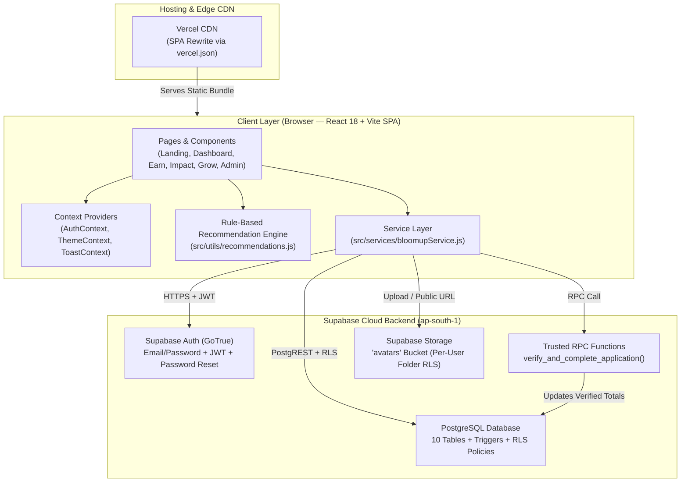
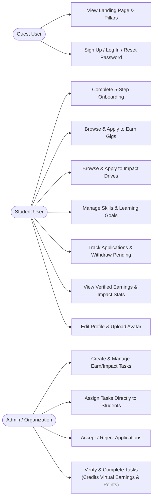
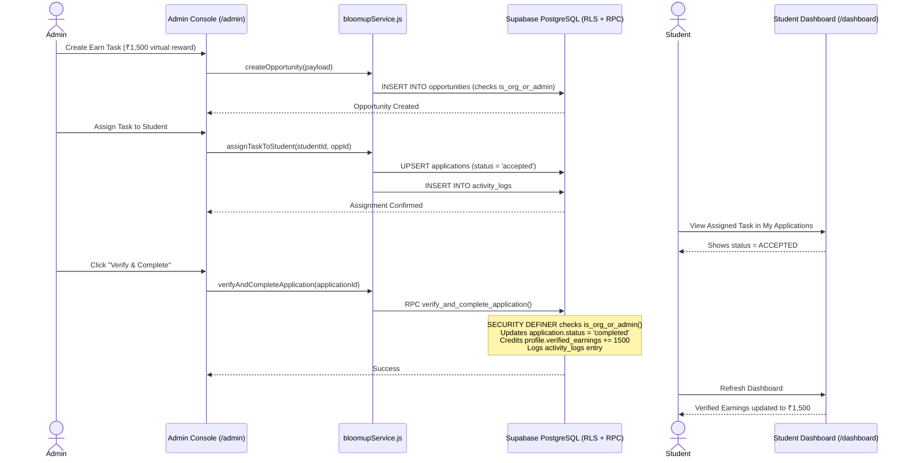
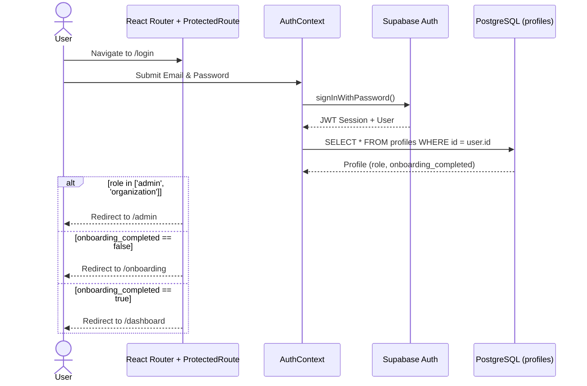
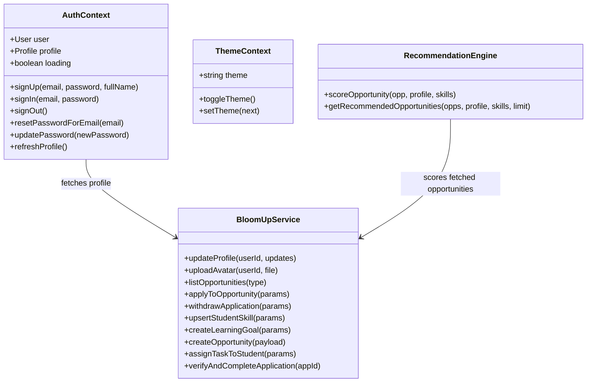
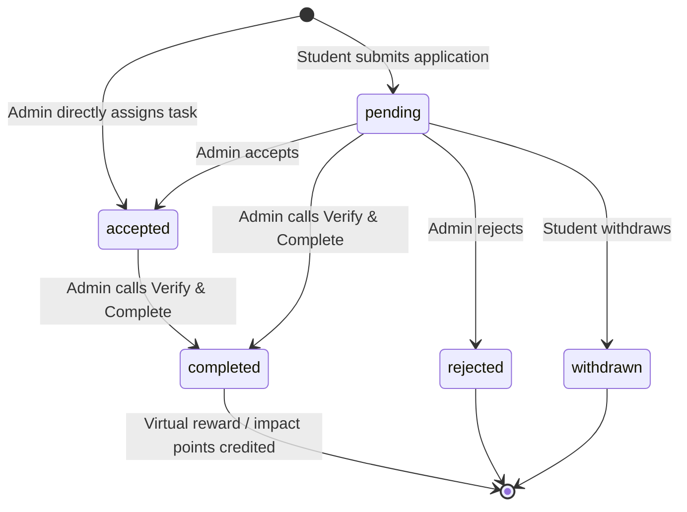

# BloomUp — System Design Diagrams (Mermaid & StarUML Reference)

You can render these diagrams directly in:
- **Mermaid Live Editor:** https://mermaid.live
- **GitHub / VS Code Markdown Preview**
- **StarUML:** Use the **Mermaid / PlantUML** import or recreate the exact classes, entities, use cases, and lifelines below.

---

## 1. High-Level System Architecture Diagram

---

## 2. Database Entity-Relationship Diagram (10 PostgreSQL Tables)

```mermaid
erDiagram
    PROFILES ||--o{ APPLICATIONS : submits
    OPPORTUNITIES ||--o{ APPLICATIONS : receives
    PROFILES ||--o{ OPPORTUNITIES : creates
    PROFILES ||--o{ STUDENT_SKILLS : possesses
    PROFILES ||--o{ LEARNING_GOALS : sets
    PROFILES ||--o{ VOLUNTEERING_RECORDS : earns
    OPPORTUNITIES ||--o{ VOLUNTEERING_RECORDS : generates
    PROFILES ||--o{ USER_ACHIEVEMENTS : unlocks
    ACHIEVEMENTS ||--o{ USER_ACHIEVEMENTS : defines
    PROFILES ||--o{ ACTIVITY_LOGS : records

    PROFILES {
        uuid id PK
        text email
        text full_name
        text avatar_url
        text location
        text college
        text course
        text academic_year
        text role "student | organization | admin"
        boolean onboarding_completed
        numeric verified_earnings
        int impact_points
        numeric volunteering_hours
        int completed_opportunities
    }

    OPPORTUNITIES {
        uuid id PK
        text type "earn | impact"
        text title
        text description
        text category
        text organization
        text[] required_skills
        numeric payment_amount
        text currency
        int impact_points
        numeric duration_hours
        text work_mode
        timestamptz deadline
        text status "open | closed | completed"
        boolean is_demo
        uuid created_by FK
    }

    APPLICATIONS {
        uuid id PK
        uuid student_id FK
        uuid opportunity_id FK
        text message
        text status "pending | accepted | rejected | completed | withdrawn"
        timestamptz verified_at
        timestamptz created_at
    }

    SKILLS {
        uuid id PK
        text name UK
        text category "technical | non-technical"
    }

    STUDENT_SKILLS {
        uuid id PK
        uuid student_id FK
        text skill_name
        text category
        text proficiency "beginner | intermediate | advanced"
    }

    LEARNING_GOALS {
        uuid id PK
        uuid student_id FK
        text title
        text description
        text skill_tag
        date target_date
        int progress
        text status "in_progress | completed"
    }

    VOLUNTEERING_RECORDS {
        uuid id PK
        uuid student_id FK
        uuid opportunity_id FK
        numeric hours_logged
        int points_awarded
        uuid verified_by FK
        timestamptz verified_at
    }

    ACHIEVEMENTS {
        uuid id PK
        text code UK
        text title
        text description
        text pillar
        int points_required
    }

    USER_ACHIEVEMENTS {
        uuid id PK
        uuid student_id FK
        uuid achievement_id FK
        timestamptz earned_at
    }

    ACTIVITY_LOGS {
        uuid id PK
        uuid student_id FK
        text action_type
        text title
        jsonb metadata
        timestamptz created_at
    }
```

---

## 3. Use Case / Role Interaction Diagram

---

## 4. Sequence Diagram — Task Assignment & Virtual Reward Verification

---

## 5. Sequence Diagram — Authentication, Route Guard & Onboarding

---

## 6. Class / Component Architecture Diagram (StarUML Class View)

---

## 7. State Diagram — Application Lifecycle

